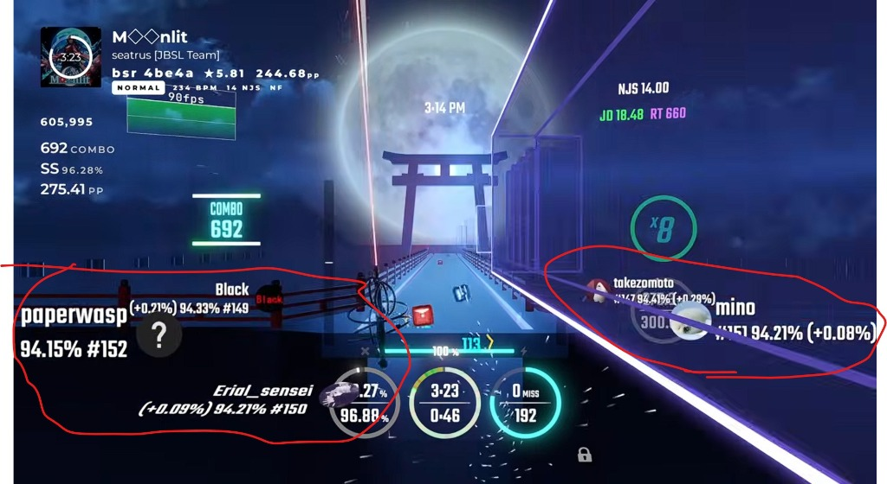

# BeatMarathon

Beat Saber `1.40.8` / `1.44.1` 向け リアルタイム・ライバル順位可視化MODです。  
BeatLeader および ScoreSaber のランキングデータを事前取得し、譜面プレイ中の現在精度（Accuracy）に応じて、ライバルプレイヤーたちとの順位変動や抜きつ抜かれつの攻防を「マラソン大会のロードサイン（看板）」または「バー表示」形式でVR空間内にリアルタイム表示します。
ScorSaberからデータ取得する方が安定します。

A real-time rival ranking visualization mod for Beat Saber `1.40.8` / `1.44.1`.  
Fetches leaderboard data from BeatLeader and ScoreSaber in advance, visualizing rank progressions and position overtakes against rival players in real time via "Marathon Road Sign" or "Vertical Bar" styles in VR.

---

> [!WARNING]
> ### 免責事項 / Disclaimer
> 
> 本MODは wacky が個人的に楽しむために作成・カスタマイズしているものです。  
> そのため、他のPC環境や将来のBeat Saberバージョンでの動作は保証できません。  
> 導入およびご利用はすべて自己責任にてお願いいたします。
> 
> This mod is created and maintained by wacky purely for personal enjoyment.  
> As such, proper operation in other environments or future Beat Saber versions is not guaranteed.  
> Please use this mod entirely at your own risk.

---

## 🏃 主な特徴 / Features

1. **リアルタイム・ライバル追従 / Real-time Rival Tracking**
   - BeatLeader / ScoreSaber のランキング（Global / Country / Friends）に対応。プレイヤーのアバターアイコン・名前・精度を表示し、現在精度に応じたごぼう抜きアニメーション演出！
   - Supports BeatLeader & ScoreSaber leaderboards (Global / Country / Friends). Displays rival avatars, player names, accuracy %, and dynamic overtake animations as your accuracy shifts!
2. **2種類の表示スタイル / 2 Display Styles**
   - **ロードサイン方式 (RoadSignMarathon)**: コース脇に看板（キロポスト）が並ぶマラソン大会の臨場感。
   - **バー方式 (VerticalBar)**: 縦型バーで直感的に順位関係や前後のプレイヤー差を把握。
3. **ごぼう抜き演出モード / Overtake Modes**
   - AUTO（最下位から駆け上がる臨場感）、Multiplier（倍率指定）、Off（通常追従）を選択可能。
   - ※倍率が0.9の場合、20ノーツカットして他のプレイヤーが表示され始めたタイミングでは自分の精度に0.9をかけた状態になります。最終的に全ノーツカット終了時に1.0になります。つまり、一曲通してずっと90％を維持した場合は「81％の位置から90％まで徐々にランキングが上がっていく」という見え方になって楽しい！
4. **高パフォーマンス設計 / High Performance**
   - GCスパイク（ガベージコレクションによるカクつき）を極力排除し、快適なVR体験を維持。
   - ※曲と難易度を選択した状態で数秒待ってからスタートすると安定しやすいです

---

## 🔧 前提MOD / Prerequisites
- [BSIPA](https://github.com/beat-saber-modding-group/BeatSaber-IPA-Reloaded) (4.3.0+)
- [SiraUtil](https://github.com/Auros/SiraUtil) (3.1.0+)
- [BeatSaberMarkupLanguage](https://github.com/monkeymanboy/BeatSaberMarkupLanguage) (BSML 1.12.0+)
- [SongCore](https://github.com/Kylemc1413/SongCore) (3.14.0+)

---

## 📦 インストール方法 / Installation
1. [Releases](../../releases) からお使いの Beat Saber バージョン（`bs1.40.8` または `bs1.44.1`）向けの ZIP をダウンロードし、中の `Plugins/BeatMarathon.dll` を Beat Saber の `Plugins` フォルダへ配置してください。
2. Download the ZIP matching your Beat Saber version (`bs1.40.8` or `bs1.44.1`) from [Releases](../../releases) and place `BeatMarathon.dll` into your Beat Saber `Plugins` folder.
